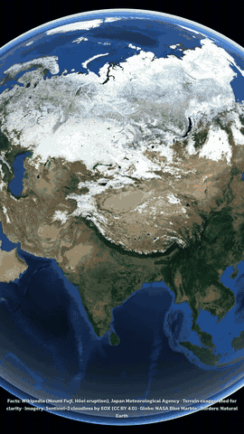
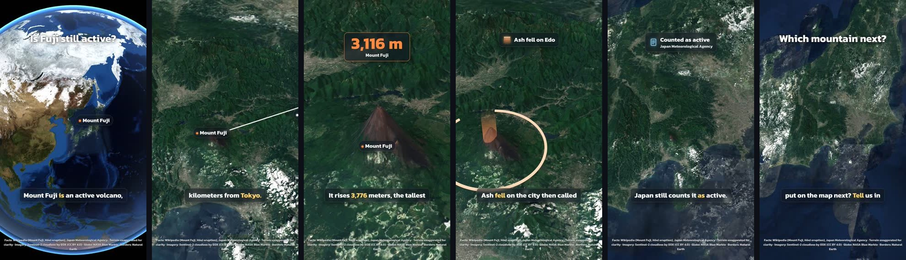
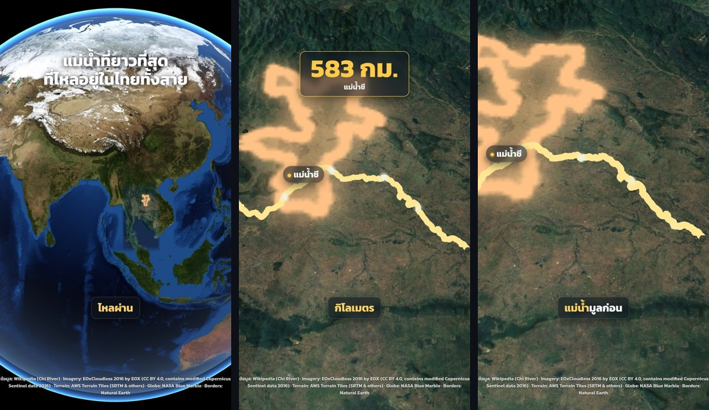
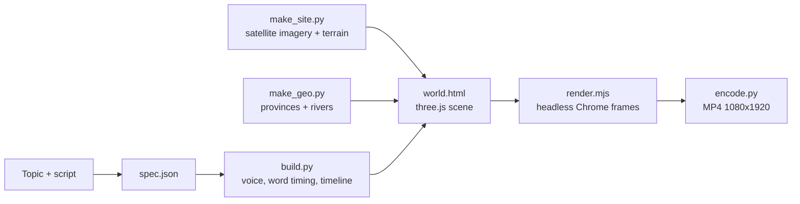

# map-shorts

**Vertical 3D map-explainer videos from a JSON file — an open-source skill for AI coding agents.**

You (or your agent) write a short script and a `spec.json`. map-shorts voices it, times every graphic to the spoken words, flies one continuous camera from a spinning NASA globe down to real satellite terrain, and renders a 1080×1920 MP4 ready for YouTube Shorts, Reels or TikTok.

  

<p align="center">
  
</p>

<p align="center"></p>
<p align="center"><sub>The <code>examples/fuji</code> clip, rendered with the free draft voice. One shot, no cuts: the globe opener, a line to Tokyo, a height counter, eruption rings, an info card and a closing question.</sub></p>

<p align="center"></p>
<p align="center"><sub>Thai works too (<code>examples/chi</code>): a Thai title, word-split Thai captions, a river traced on the relief and a province overlay.</sub></p>

---

## เริ่มต้นใช้งาน (ภาษาไทย)

map-shorts คือ skill ฟรีสำหรับ Claude Code ใช้ทำคลิปแนวตั้งอธิบายเรื่องราวบนแผนที่ 3D: กล้องดิ่งจากลูกโลกลงไปยังภูมิประเทศจริงในช็อตเดียว มีเสียงพากย์ ซับขึ้นตามคำพูด การ์ดข้อมูล และเส้นแม่น้ำหรือเขตจังหวัดบนแผนที่ ได้ไฟล์ MP4 ขนาด 1080×1920 พร้อมลง Shorts, Reels หรือ TikTok

**สิ่งที่ต้องมี:** [Claude Code](https://claude.com/claude-code) อย่างเดียว ที่เหลือให้ Claude ติดตั้งให้

**ขั้นที่ 1: ติดตั้ง** เปิด Claude Code ในโฟลเดอร์ว่างๆ แล้วคัดลอกข้อความนี้ไปวางทั้งก้อน

```text
ติดตั้ง map-shorts ให้หน่อย: clone https://github.com/Heenzaa1998/map-shorts ลงโฟลเดอร์นี้ แล้วทำตามหัวข้อ Install ใน README.md ให้ครบทุกขั้น ถ้าเครื่องยังไม่มี Python, Node.js หรือ ffmpeg ให้บอกคำสั่งติดตั้งที่เหมาะกับระบบของฉัน และขออนุญาตก่อนติดตั้งทุกครั้ง จากนั้นคัดลอกโฟลเดอร์ skill/map-shorts ไปไว้ที่ ~/.claude/skills/ แล้วรัน check_setup.py จนไม่มีบรรทัด -- เหลือ (บรรทัด opt ข้ามได้) สุดท้ายทำคลิปตัวอย่าง examples/fuji ให้ฉันดู โดยส่งภาพนิ่งให้ดูก่อน และถ้าเครื่องไม่มีการ์ดจอให้บอกก่อนเรนเดอร์เต็ม
```

**ขั้นที่ 2: สั่งทำคลิป** เช่น

```text
ทำคลิป map-shorts เรื่องทำไมกรุงเทพถึงน้ำท่วมง่าย เป็นภาษาไทย
```

Claude จะถามคำถามสั้นๆ ก่อน (หัวข้อ คนดู ช่องหารายได้หรือยัง ใช้เสียงอะไร) จากนั้นเสนอมุมเล่า เขียนสคริปต์ให้คุณอนุมัติ แล้วส่งภาพตัวอย่างให้ดูก่อนเรนเดอร์จริง

**ต้องรู้ก่อนใช้**
- **เสียงพากย์:** เสียงฟรี (Edge TTS) ใช้ทำร่างได้เท่านั้น ห้ามใช้กับช่องที่หารายได้ ถ้าจะลงจริงให้ใช้ ElevenLabs แบบเสียเงิน ([รายละเอียด](#voices))
- **ความเร็ว:** เครื่องที่มีการ์ดจอ (รวมถึงการ์ดจอในตัวของโน้ตบุ๊กรุ่นใหม่) เรนเดอร์คลิป 30 วินาทีเสร็จในราว 1 นาที ถ้าไม่มีจะช้ามาก (ราว 30 นาที)
- **เครดิต:** ต้องใส่เครดิตภาพดาวเทียมและข้อมูลความสูงไว้ในคำอธิบายคลิปทุกครั้ง มีข้อความให้คัดลอกในหัวข้อ [Credits](#credits-you-must-put-on-your-videos)
- **สถานะ:** ยังเป็นรุ่น beta ถ้าเจอปัญหา เปิด issue ได้ที่ GitHub

---

## Contents
- [เริ่มต้นใช้งาน (ภาษาไทย)](#เริ่มต้นใช้งาน-ภาษาไทย)
- [What you get](#what-you-get)
- [How it works](#how-it-works)
- [Requirements](#requirements)
- [Install](#install)
- [Make a clip with your agent](#make-a-clip-with-your-agent)
- [Make the example by hand](#make-the-example-by-hand)
- [Writing a spec](#writing-a-spec)
- [Voices](#voices)
- [Credits you must put on your videos](#credits-you-must-put-on-your-videos)
- [Rendering speed and GPUs](#rendering-speed-and-gpus)
- [Troubleshooting](#troubleshooting)
- [Known limitations](#known-limitations)
- [Privacy and safety](#privacy-and-safety)
- [Project layout](#project-layout)
- [Contributing](#contributing) · [License](#license)

---

## What you get

**The look**
- One continuous camera shot: globe → country → close-up over exaggerated real terrain. No stock footage, no cuts.
- Map overlays: country and province fills, glowing beacons, rings, lines and arcs, and rivers traced on the relief with flowing drops.
- Screen graphics: titles, glass info cards with icons, counters that count up, labels pinned to places, a flash for big moments.
- Captions that highlight each word as it is spoken (Thai is split into real words).

**The method** — the skill carries what we learned running a map Shorts channel, so the agent does more than run commands:
- how to pick topics people watch to the end: viewer stakes, a common wrong belief, and a visual only a 3D map can give;
- script and hook rules, and pacing (something new on screen every 3–4 s);
- a QA checklist, fact-checking and honesty rules;
- the agent asks you a few questions first and gives advice at the right moments (voice quality, licences, render speed, weak topics, unverified numbers, reading your day-3 analytics).

## How it works



Every time in the spec can point at a spoken word: `"@2:Ash"` means "when the word *Ash* starts in line 2". If you change the script, the camera and the graphics move with the new timing automatically.

## Requirements

| Need | Why | Check |
|---|---|---|
| Python 3.10+ | build, map data | `python3 --version` |
| Node.js 18+ | rendering | `node --version` |
| ffmpeg + ffprobe | audio and video | `ffmpeg -version` (Windows: `winget install --id Gyan.FFmpeg -e`, macOS: `brew install ffmpeg`) |
| Chrome or Chromium | renders the 3D page | installed by Playwright, or pass `--chrome <path>` |
| Internet | voices, map tiles, Natural Earth (first run) | — |
| An AI coding agent (recommended) | writes and tunes the spec with you | e.g. [Claude Code](https://claude.com/claude-code) |
| A GPU (recommended; a laptop iGPU is enough) | about 30× faster renders (measured) | the render prints `renderer: ...` |

## Install

```bash
# 1. get the code
git clone https://github.com/Heenzaa1998/map-shorts.git
cd map-shorts

# 2. Python packages (a virtual environment is a good idea)
python3 -m venv .venv && source .venv/bin/activate      # Windows: .venv\Scripts\activate
pip install -r requirements.txt

# 3. the headless browser driver (use playwright-core: it matches the pinned version)
npm install
npx playwright-core install chromium

# 4. check everything
python3 skill/map-shorts/scripts/check_setup.py .
```

Cloning creates a `map-shorts/` folder; run the rest inside it.

The check prints `OK`, `--` (needed, with the fix) or `opt` (optional, e.g. an ElevenLabs key) for each part. It changes nothing.

The browser goes to Playwright's cache (`~/.cache/ms-playwright`, on Windows `%LOCALAPPDATA%\ms-playwright`), about 200 MB. Use `npx playwright-core ...`, not `npx playwright ...`: the latter fetches a browser for a different version.

**Or let Claude Code install it:** paste this into Claude Code in an empty folder:

```text
Install map-shorts for me: clone https://github.com/Heenzaa1998/map-shorts into this folder and follow every step of the Install section in README.md. If Python, Node.js or ffmpeg is missing, tell me the right install command for my system and ask before installing anything. Then copy skill/map-shorts to ~/.claude/skills/, run check_setup.py until no "--" lines remain ("opt" lines are optional), and make the examples/fuji clip for me: show me stills first, and if there is no GPU tell me before the full render.
```

**Add the skill to your agent.** For Claude Code:

```bash
cp -r skill/map-shorts ~/.claude/skills/
```

Other agents that read `SKILL.md` folders work the same way: point them at `skill/map-shorts`.

## Make a clip with your agent

Open your agent in the folder where you ran `npm install` and ask, for example:

> Make a map-shorts clip about why the Dead Sea is so salty.

> ทำคลิป map-shorts เรื่องทำไมกรุงเทพถึงน้ำท่วมง่าย เป็นภาษาไทย

The agent follows the skill:

1. **Asks first:** topic and audience, whether the channel is monetised (this decides which voices and data are allowed), which voice to use, whether you have a GPU, and whether you have your own music.
2. **Suggests a stronger angle** for the topic, then writes a 4–7 line script for you to approve.
3. **Downloads map data** for the area.
4. **Writes the spec and builds it.**
5. **Shows you still frames** so framing can be fixed cheaply, before the slow full render.
6. **Renders and encodes the MP4.** Then it asks you to **listen to the voice** (only a human catches a mispronounced name).
7. **Drafts the title, description, sources and credits.** It never publishes for you.

## Make the example by hand

Useful to check your setup, or to learn the format.

```bash
S=skill/map-shorts/scripts

# 1. map data for the area (cached in examples/fuji/.tiles)
python3 $S/make_site.py examples/fuji --name region --box 26 44 126 146 --zimg 8 --zter 7 --grid 512   # wide view
python3 $S/make_site.py examples/fuji --box 34.9 36.0 138.0 139.4 --zimg 12 --zter 11                    # close-up

# 2. voice + timing + scene
python3 $S/build.py examples/fuji

# 3. look at a few stills first (seconds)
node $S/render.mjs examples/fuji --times 3,8,15,22
#    -> examples/fuji/build/frames/t3.jpg ...

# 4. full render (minutes) and encode
node $S/render.mjs examples/fuji
python3 $S/encode.py examples/fuji v1
#    -> examples/fuji/build/fuji-v1.mp4
```

`--box` is `south north west east` in degrees. Region patches are typically 15–30° wide; close-ups are 1–2° wide.

The Thai example also needs provinces and rivers:

```bash
python3 $S/make_site.py examples/chi --name region --box 5 21 97 106 --zimg 8 --zter 7 --grid 512
python3 $S/make_geo.py  examples/chi --region "KhonKaen_UdonThani=Thailand:Khon Kaen,Udon Thani" --river "chi=Chi"
python3 $S/build.py     examples/chi
```

`make_geo.py --list-provinces Thailand` prints the province names Natural Earth uses for a country.

## Writing a spec

A small but complete spec:

```json
{
  "voice": {"provider": "edge", "voice": "en-US-AriaNeural"},
  "lines": [
    "Mount Fuji is an active volcano, about a hundred kilometers from Tokyo.",
    "It rises 3,776 meters, the tallest mountain in Japan."
  ],
  "spoken": {"3,776": "three thousand seven hundred seventy six"},
  "relief": {"ex": 3, "k0": 0.15, "at": "@0:Mount", "dur": 2.6, "hclamp": 4000},
  "cam": [
    [2.0, 137.0, 35.6, 2200, 0, 0, 0],
    ["B1-0.2", 138.7274, 35.3606, 70, 48, 0, 8]
  ],
  "q":  [{"type": "beacon", "lon": 138.7274, "lat": 35.3606, "color": "#FF8A3D", "at": "@0:Mount", "until": "B1"}],
  "ui": [{"type": "counter", "y": 240, "from_": 0, "to": 3776, "t0": "@1:rises", "t1": "@1:meters>", "suffix": " m", "label": "Mount Fuji", "at": "@1:rises", "until": "END+1"}],
  "credits": "Facts: Wikipedia (Mount Fuji)"
}
```

**Times**

| Write | Means |
|---|---|
| `4.5` | 4.5 s from the start |
| `"@2:Ash"` | when the word "Ash" starts in line 2 (lines count from 0) |
| `"@2:Edo>"` | when "Edo" ends |
| `"@2:Ash-0.2"` | 0.2 s before "Ash" |
| `"B3"`, `"B3+0.5"` | start of line 3 |
| `"END"`, `"END+1"` | end of the voice |

**Camera keys:** `[time, lon, lat, range_km, tilt, heading, target_height_km]`
- `range_km`: 21000 is the whole globe, 2000 a country, 50 a mountain.
- `tilt`: 0 looks straight down; 45–60 is a dramatic oblique view.
- `target_height_km` is measured in *exaggerated* space: for a 3.8 km peak with `ex: 3`, use about 8.

**Building blocks**
- Map elements (`q`): `country`, `beacon`, `ring`, `line`, `arc`, `path`.
- Screen elements (`ui`): `title`, `pill`, `cards`, `counter`, `ring`, `flash`.

Every field is in [`skill/map-shorts/references/spec.md`](skill/map-shorts/references/spec.md).

**Tips that save the most time**
- Render stills after every camera change. Change one thing at a time.
- Keep something changing every 3–4 seconds; hold each card at least 2 seconds so people can read it.
- Keep text out of the top ~210 px and bottom ~310 px; the platforms cover those areas.
- Fade country outlines out before close-ups (they get soft below ~500 km).

## Voices

| Provider | Cost | Quality | Use for |
|---|---|---|---|
| `edge` (default) | free | robotic, especially in Thai; coarse word timing | **drafts only** |
| `elevenlabs` | your plan | natural, accurate timing | final videos (check your plan's terms) |

```json
"voice": {"provider": "elevenlabs", "voice_id": "YOUR_VOICE_ID", "model": "eleven_v3", "lang": "th", "speed": 1.06}
```

Set the key in your shell (`export ELEVENLABS_API_KEY=...`). Never put it in the spec.

> **Do not publish monetised videos with the Edge voice.** It uses Microsoft Edge's read-aloud service through an unofficial library. Microsoft has said commercial use without an Azure subscription may break its terms, and the service can stop working at any time.

Voice lines are cached by their text, so after you change a camera key or a graphic, a rebuild costs nothing. Only changed lines are voiced again.

**Pronunciation:** use `spoken` to tell the voice how to say a word while the captions keep the written form, e.g. `"spoken": {"1707": "seventeen oh seven", "แมกมา": "แม็กม่า"}`.

## Credits you must put on your videos

The build already puts a credit line at the bottom of every video. Put the full text in your video description too:

```
Imagery: EOxCloudless https://cloudless.eox.at by EOX IT Services GmbH (Contains modified Copernicus Sentinel data 2016), CC BY 4.0
Terrain: AWS Terrain Tiles (SRTM and others) + the notices for your area: https://github.com/tilezen/joerd/blob/master/docs/attribution.md
Globe: NASA Blue Marble · Borders, provinces, rivers: Natural Earth
Terrain exaggerated for clarity; beams and rings are illustrations.
```

- `make_site.py` only uses EOX's **2016** layer, which allows commercial use. Their 2018 and later layers are **non-commercial** — do not switch to them for a monetised channel.
- Details: [`references/licenses.md`](skill/map-shorts/references/licenses.md). This is not legal advice.

## Rendering speed and GPUs

| Setup | Speed | 30 s clip |
|---|---|---|
| Software rendering (`--swiftshader`, any machine; also WSL) | ~0.5 frames/s (measured) | ~30 min |
| GPU through Chrome (Windows 11, AMD Radeon 860M laptop iGPU) | ~16 frames/s (measured) | ~1 min |

- The first line of a render tells you which renderer is in use. `SwiftShader` means software rendering.
- **Split a long render** across processes:
  ```bash
  node render.mjs clip --from 0 --to 450 &
  node render.mjs clip --from 450 --to 942 &
  ```
- **WSL:** Chrome inside WSL has no GPU. Clone and run the project on the Windows side instead (Windows Python + Node); it uses the GPU directly.

## Troubleshooting

| You see | Do this |
|---|---|
| `missing .../data_extra/region.json` | Run `make_site.py <clip> --name region --box ...` first. Every clip needs its own map data. |
| `time ref: 'X' is not in beat N` | The phrase is not in that line exactly as written. Lines count from 0; use the written words, not the `spoken` respelling. |
| `camera keys must run forward in time` | Two camera keys resolved to the same or a backwards time. Move one to a later word. |
| `unknown country/region names` | Countries use Natural Earth `ADMIN` names (e.g. `"United States of America"`). Regions come from `make_geo.py`. |
| `playwright-core not found` | Run `npm i playwright-core` in the folder you run `render.mjs` from. |
| `Executable doesn't exist at ...ms-playwright...` | Install the browser that matches the pinned version: `npx playwright-core install chromium` (not `npx playwright ...`). |
| `encoded with libopenh264` | Your ffmpeg has no x264. The file is fine; install a full build (see Requirements) for the best quality. |
| `Edge TTS gave no audio after 6 tries` | The free service is flaky. Wait a minute and run `build.py` again (finished lines are cached). |
| `renderer: ... SwiftShader` and very slow | No GPU in use. See [Rendering speed](#rendering-speed-and-gpus). |
| Blurry ground at mid zoom | Make the region patch cover the area the camera flies over, or raise `--zimg` by 1. |
| A province fill disappears under mountains | Raise its `lift` (30+). |
| A phrase like `COVID-19` breaks timing | `-19` is read as an offset; reference another word in that line. |

## Known limitations

This is a **beta**. Please open an issue if something breaks.

- **Tested end to end** on Windows 11 (GPU rendering) and Linux, with both the free Edge voice and the ElevenLabs voice (Thai, `eleven_v3`). Other systems should work too; if something breaks, please open an issue.
- **Not one-click:** framing takes a few rounds of stills per clip.
- **Thai with Edge TTS:** captions often show only one or two words at a time, because its word timing is coarse. ElevenLabs gives smoother captions.
- **Map graphics:** outlines look soft in close-ups; beacons can look like flat bars from some angles.
- **Not included:** music, sound effects and voices. Bring your own; CC0 sounds are fine. Add them with `"music"` and `"sfx_files"` in the spec.

## Privacy and safety

- **Where your text goes:** your script is sent to the voice service you choose (Microsoft for Edge, ElevenLabs with your key). Map tiles and Natural Earth files are downloaded from EOX, AWS and Natural Earth.
- **The renderer** serves only the clip and template folders, on `127.0.0.1`, to a headless Chrome. It keeps the browser sandbox on.
- **Treat a `spec.json` from someone else as code:** it can reference local files as audio and inject HTML into the page. Read it before you build.
- **No keys are stored:** `ELEVENLABS_API_KEY` is read from the environment only.

## Project layout

```
skill/map-shorts/
  SKILL.md                 instructions the agent follows
  references/              method, spec, thai, qa, setup, licenses, advice
  scripts/
    check_setup.py         dependency check
    make_site.py           satellite imagery + terrain patches (EOX 2016, AWS Terrain Tiles)
    make_geo.py            provinces and rivers (Natural Earth)
    build.py               voice, word timing, timeline, scene
    render.mjs             headless Chrome frame capture
    encode.py              MP4 (H.264 + AAC)
  template/                three.js scene parts, three.js, Kanit font, globe, country borders
examples/fuji/             English example
examples/chi/              Thai example
docs/                      README images
```

## Contributing

Issues and pull requests are welcome — especially test reports from Windows, macOS and GPU machines.

When you open an issue, include:
- the output of `check_setup.py`;
- the `renderer:` line from your render;
- the full error message.

## License

- **Code and docs:** MIT.
- **Bundled third-party files** keep their own licences (three.js MIT, Kanit OFL, Natural Earth public domain, NASA Blue Marble); see [`NOTICE.md`](NOTICE.md).
- **Images in `docs/`** contain EOxCloudless 2016 imagery by EOX IT Services GmbH (Contains modified Copernicus Sentinel data 2016), CC BY 4.0.
- **Videos you make** must carry the imagery and terrain credits above.
